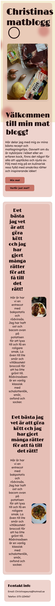
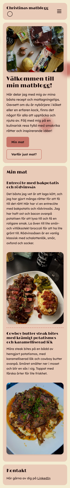
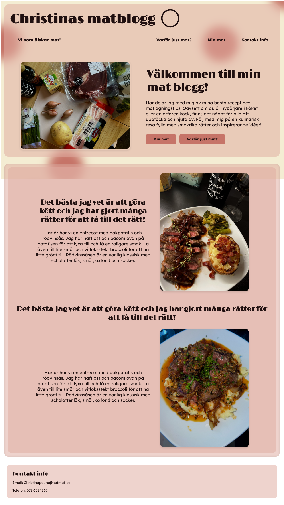
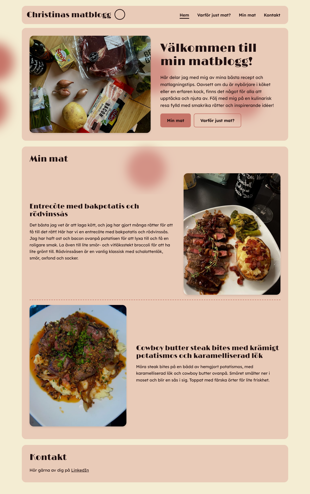

# Christinas matblogg

En hemsida om mat som jag själv har lagat och fotograferat. Projektet var mitt slutprov i HTML och CSS hösten 2025. Ett år senare gick jag tillbaka och byggde om det med det jag kan i dag, så att man kan se hur jag har utvecklats.

Originalet finns sparat precis som det lämnades in under taggen [`v1-skolinlamning`](https://github.com/Zhesla/slut-prov/tree/v1-skolinlamning).

## Före och efter

| | Före (2025) | Efter (2026) |
|---|---|---|
| Mobil |  |  |
| Dator |  |  |

### Lighthouse

| | Före (2025) | Efter, mobil | Efter, dator |
|---|---|---|---|
| Performance | 75 | 82 | 98 |
| Accessibility | 97 | 100 | 100 |
| Best Practices | 100 | 100 | 100 |
| SEO | 91 | 100 | 100 |

Siffrorna från 2025 är de jag skrev upp när jag lämnade in projektet. Mobil testas med en simulerad långsam telefon och uppkoppling, därför blir Performance lägre där.

## Vad jag skrev 2025

När jag lämnade in projektet skrev jag i min README att bilderna var större än de behövde vara, att flexbox var svårt när man skalar upp och ner och att jag behövde prioritera mobile first ännu mer. Det var precis de sakerna jag började med när jag byggde om sidan.

## Vad jag ändrade

**Mobil**
- Menyn försvann helt på mobilen på startsidan. Nu finns en menyknapp på båda sidorna som går att öppna, stänga och använda med tangentbordet.
- En bild var 1500 px bred, så hela sidan gick att scrolla i sidled på mobilen. Nu anpassar sig alla bilder efter skärmen.
- CSS:en är omskriven mobile first. Grundreglerna gäller mobilen och större skärmar läggs på med `min-width`.

**Prestanda**
- Bilderna laddades i full storlek. Nu skickar Cloudinary en lagom stor bild i rätt format beroende på skärmen (`srcset`, `f_auto`, `q_auto`).
- Bilder längre ner på sidan laddas först när man scrollar dit (`loading="lazy"`).
- Typsnitten laddas med `<link>` i stället för `@import`, som blockerade sidan. Ett typsnitt som aldrig användes är borttaget.

**Kodkvalitet**
- `* { margin: 5px; padding: 5px; }` gav luft på allt och var den stora orsaken till att flexbox krånglade. Den är borta.
- Taggar som inte stängdes och dubbla CSS-regler som skrev över varandra är fixade.
- Text som var kopierad två gånger är ersatt med riktigt innehåll.

**Tillgänglighet**
- Rubrikerna går i rätt ordning (en `h1` per sida, sedan `h2` och `h3`).
- Bilderna har alt-texter som beskriver vad som syns i stället för "Mat bild".
- Knapparna går att läsa även på hover. Förut blev det vit text på ljusrosa.
- Det finns en länk för att hoppa direkt till innehållet.
- Bakgrundsbollarna slutar snurra för den som har valt "minska rörelse" i sina inställningar.

**Integritet**
- Min mejladress är utbytt mot en länk till min LinkedIn.

## Vad jag har lärt mig

- **Mobile first på riktigt.** Att börja med den minsta skärmen och bygga uppåt gör CSS:en både kortare och lättare att förstå.
- **Varför globala regler är farliga.** En enda rad med `*` kan ställa till det för hela layouten.
- **Bildoptimering.** Rätt storlek och format på bilderna gör mer för prestandan än nästan allt annat.
- **Tillgänglighet är mer än alt-texter.** Rubrikordning, kontrast, tangentbord och rörelse spelar också roll.
- **Git som verktyg.** Taggar för att spara en version, tydliga commit-meddelanden och att kunna jämföra gammalt med nytt.

## Teknik

- HTML och CSS
- Lite JavaScript för mobilmenyn
- Bilder via Cloudinary

## Kontakt

[LinkedIn](https://www.linkedin.com/in/christina-peura/)
